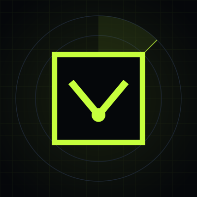

<p align="center">
  
</p>

# Trenchwatch

**Real-time detection of serial token operators and their bots on Solana launchpads.**
*We name the operator behind the launch.*

Every day, thousands of tokens launch on Solana. A small group of repeat operators launches a large share of them, often from fresh wallets, while their bots buy in the opening seconds. Trenchwatch watches the launchpads live, attributes each launch to the operator behind it, and alerts the platforms that want to protect their users, seconds after the launch.

> This repository is the public overview of Trenchwatch: what it does, how to integrate it, and how to work with us. The detection engine itself is proprietary and is not published here.

---

## At a glance

| | |
| --- | --- |
| Launchpads covered live | **5**: pump.fun, Meteora DBC, Raydium LaunchLab, Bags, Bonk.fun |
| Token launches recorded | **23,783** |
| Early purchases analysed | **188,202** |
| Serial creators and operators in the registry | **520** |
| Launches from creators already in the registry | **42%** |
| Median time from launch to alert | **3.8 s** |

*Data to 15 October 2026. Validation is ongoing; early results are in the [overview deck](Trenchwatch%20Public%20Overview.pdf).*

## What it does

1. **Detect:** every new launch on supported launchpads, as it happens.
2. **Attribute:** links the creator and the early buyers to known operators and their wallet clusters.
3. **Alert:** Telegram, email or a signed webhook, within seconds of the launch.
4. **Evidence:** every alert carries the on-chain trail behind it, ready for review.

```
Token launches on-chain  →  Trenchwatch sees it  →  Matched to known operators  →  Alert with evidence
```

Clients receive the alert, a risk level, a stable operator ID and the on-chain evidence. The detection method stays private, so operators cannot learn to avoid it.

## What an alert looks like

*(Sandbox example, synthetic data.)*

```json
{
  "api_version": "2026-10",
  "id": "A-20261015-000001",
  "type": "operator_launch",
  "level": "RELATED",
  "detected_at_utc": "2026-10-15 01:00:03",
  "token": "7xKp…3fQa",
  "operator": {"id": "TW-9001", "address": "HPGg…sJj8"},
  "summary": "Tracked operator TW-9001 created a new token.",
  "evidence": [{"step": "create", "transaction": "<signature>"}],
  "transaction": "<signature>",
  "sandbox": true
}
```

Alerts follow **[Solana Launch Alerts](https://github.com/ivanalonso-dev/solana-launch-alerts)**, an open MIT-licensed standard for launch-risk alerts that we maintain, with verified SDKs for TypeScript and Python.

## Integration

| Channel | For | Notes |
| --- | --- | --- |
| Telegram and email | Trust and safety teams | Live from day one, no engineering needed |
| Signed webhooks | Your systems | HMAC-SHA256, replay protection, automatic retries |
| REST API | Products and dashboards | Token risk, address role, latest alerts |
| Sandbox | Evaluation | Synthetic data and test keys, same shapes as production |

- **[API documentation](docs/api/README.md)**
- **[OpenAPI specification](docs/api/openapi.yaml)**

Test keys and sandbox access are available on request.

## Who it is for

| Who | What they get |
| --- | --- |
| Launchpads | Early warning on serial operators using the platform |
| Wallets | Context to show users before they buy |
| Trading terminals | Operator labels next to every new token |
| Security and analytics firms | A live operator registry for Solana launchpads |

## Principles

- **Public data only.** Every input comes from the public Solana ledger.
- **Addresses, not people.** We label wallets and behaviour, never individuals.
- **Client data stays private.** Each client sees only its own alerts and reports.
- **No trading on our own signals.** Trenchwatch does not trade on its alerts.
- **On the platforms' side.** We work with platforms to protect their users.

Alerts are probabilistic observations, not financial advice.

## Work with us

- **License:** alerts and API for your platform. Start with a free analysis of a case from your own launchpad.
- **Partner:** integrators, agencies and advisors who want to bring Trenchwatch to their clients.
- **Collaborate:** security and analytics firms that want to integrate the operator registry into their products.

**Contact:** [emerge.trenchwatch@gmail.com](mailto:emerge.trenchwatch@gmail.com) · X: [@TrenchwatchTech](https://x.com/TrenchwatchTech) · Overview deck: [Trenchwatch Public Overview.pdf](Trenchwatch%20Public%20Overview.pdf)

---

Trenchwatch is built by **Ivan Alonso** at **EMERGE**. [GitHub](https://github.com/ivanalonso-dev) · [LinkedIn](https://linkedin.com/in/ivanalonsobcsentinel)

© 2026 Ivan Alonso (EMERGE). All rights reserved. See [NOTICE](NOTICE).
